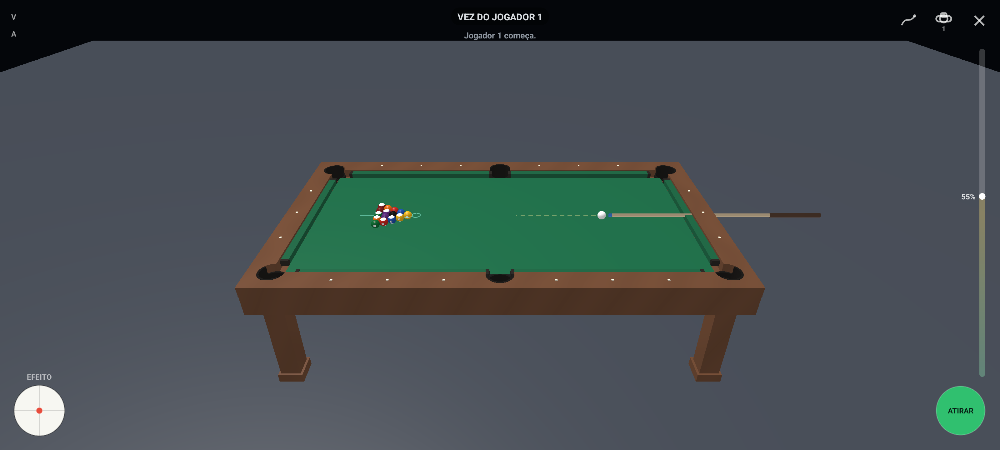

# Sinuca Bluetooth

[](https://github.com/ldmaster/sinuca-bluetooth/actions/workflows/android.yml)

Jogo de sinuca 8-ball **nativo para Android**, para exatamente **dois aparelhos**
conectados por **Bluetooth clássico (RFCOMM)**. A mesa e o taco são modelos 3D
gerados no **Blender** com o harness `blender-forge`; as bolas usam esferas de
alta tesselação com texturas procedurais de número e listra. O jogo é
Kotlin + OpenGL ES 3.0, sem engine externa.

A mesa segue as medidas reais de uma mesa de torneio de 9 pés (área de jogo
2,54 × 1,27 m, bolas de 57,15 mm, bocas de 116/127 mm). As caçapas são
**círculos completos tangentes à linha da boca**, com copo revestido e a
madeira contornando a abertura; o pano é recortado no círculo, então o verde
não é invadido e o buraco não fica pela metade. As medidas, fontes e a correspondência com a física estão em
[`docs/table-spec.md`](docs/table-spec.md); o relatório do laboratório de física
fica em [`docs/physics-report.md`](docs/physics-report.md).



Vistas extras: [100% de cima, com as caçapas](docs/screenshot-top.png) ·
[trajetória prevista](docs/screenshot-trajectory.png).

## O que está implementado

- Mesa de 9 pés modelada a partir de especificações WPA/BCA: área de jogo
  2,54 × 1,27 m, trilho de 195 mm, almofadas com nariz a 36 mm (63,5% da bola),
  pano de 4 mm sobre slate escuro, copo revestido e facetas de borracha nas
  pontas das almofadas. As caçapas são círculos completos tangentes à linha da
  boca, com a metade frontal do aro rebaixada para a bola entrar; o buraco fica
  dentro da madeira. Nada ultrapassa a moldura.
- Bolas de 64×48 segmentos com textura 768×384 de número/listra, brilho
  especular e uma luz pontual sobre a mesa para dar volume às bolas de cor
  única.
- Física própria calibrada contra a mesa real: atrito de rolamento + arrasto,
  subpassos de 0,45 mm, colisão por cápsula nas almofadas (mandíbulas
  arredondadas), restituição 0,88 nas tabelas e direção da bola-alvo igual à
  bola fantasma com erro máximo de 0,26°. A força é progressiva: 3% move
  ~20 cm, 10% ~0,86 m, 25% ~2,3 m, 50% ~4,5 m (com tabelas) e 100% sai a
  6,2 m/s.
- **Efeito (english)**: selecione o ponto de acerto na bola branca. Parte baixa
  faz a branca voltar (draw), parte alta segue em frente (follow), laterais
  curvam a trajetória e alteram o quique nas tabelas.
- Indicador em tempo real da bola na mira: anel fantasma no ponto de contato,
  destaque na bola-alvo e seta com a direção que ela vai tomar. A seta usa a
  normal do contato real (bola fantasma); o laboratório garante que a direção
  simulada coincide com a prevista.
- Trajetória completa opcional: simula a tacada com a força, ângulo e efeito
  atuais (incluindo tabelas e caçapas) e desenha o caminho da branca e da
  primeira bola atingida. A simulação roda em **thread própria**, com física
  reutilizada e pedidos coalescidos: arrastar a mira não bloqueia a renderização.
- Mira por arrasto relativo, sem salto para onde o dedo tocou.
- Barra de força vertical discreta, botão de tacada pequeno e HUD sem painéis:
  bolas encaçapadas, vez, ícones de câmera/trajetória/sair e efeito ficam nos
  cantos.
- Quatro perspectivas de câmera (3/4, alta, baixa e 100% de cima).
- Rolamento visual das bolas proporcional à velocidade.
- Multiplayer host-autoritativo: o host simula e envia snapshots (~16 Hz); o
  cliente prevê localmente e recebe correções. Apenas uma conexão é aceita.
- Fluxo Bluetooth: criar partida (visível por 5 min) ou entrar em partida
  (aparelhos pareados + descoberta).
- Modo **Treino local** para jogar sozinho e testar tudo sem Bluetooth.

## Requisitos

- Android 8.0+ (minSdk 26), compilado/targetSdk 36.
- Dois celulares com Bluetooth. **Pareie os dois antes de jogar** nas
  configurações do Android — o app não faz o pareamento sozinho.
- Para compilar: JDK 17+, Android SDK 36 e o wrapper incluído (Gradle 9.4.1).

## Compilar e instalar

```bash
./gradlew :app:assembleDebug
adb install -r app/build/outputs/apk/debug/app-debug.apk
```

APK de teste: `app/build/outputs/apk/debug/app-debug.apk` (pacote
`com.ldmaster.sinuca`). O CI publica um **release assinado**; para gerar um
release assinado localmente, copie `keystore.properties.example` para
`keystore.properties` (arquivo ignorado pelo git) ou exporte
`SINUCA_KEYSTORE`, `SINUCA_KEYSTORE_PASSWORD`, `SINUCA_KEY_ALIAS` e
`SINUCA_KEY_PASSWORD`:

```bash
./gradlew :app:assembleRelease
```

O CI usa os secrets `ANDROID_KEYSTORE_BASE64`, `ANDROID_KEYSTORE_PASSWORD`,
`ANDROID_KEY_ALIAS` e `ANDROID_KEY_PASSWORD` e publica o APK assinado em cada
tag `v*`. A chave é estável, então as próximas versões atualizam por cima.

> **Primeira atualização assinada:** a 1.5.0 foi publicada com assinatura de
> debug. Ao instalar a 1.6.0 (assinada com a chave de release) pela primeira
> vez, desinstale a 1.5.0. Da 1.6.0 em diante, o Android atualiza normalmente.

## Como jogar

1. Pareie os dois celulares no Android.
2. **Host:** toque em *Criar partida* e aceite ficar visível.
3. **Visitante:** toque em *Entrar em partida* e selecione o outro aparelho.
4. Quando a mesa aparecer, o jogador 1 dá a primeira tacada.

Controles (paisagem, tudo nos cantos):

- **Mira:** arraste sobre a mesa. O movimento é relativo: continue arrastando em
  qualquer lugar para girar mais.
- **Força:** arraste a barra vertical fina na borda direita (para cima aumenta).
- **Efeito:** toque na bolinha **EFEITO** no canto inferior esquerdo; o ponto
  vermelho indica onde a tacada acerta a branca.
- **Tacada:** toque no círculo **ATIRAR** no canto inferior direito.
- **Trajetória:** ícone de curva no canto superior direito (liga/desliga).
- **Câmera:** ícone de câmera no canto superior direito alterna as 4 vistas.
- **Sair:** **X** no canto superior direito.
- **Bolas encaçapadas:** fileiras discretas **V** (você) e **A** (adversário)
  no canto superior esquerdo.

## Regras adotadas

- Jogador 1 é sólidas (1–7); jogador 2 é listradas (9–15). A 8 vale para ambos.
- Encaçapar uma bola do próprio grupo mantém a vez; não encaçapar nada passa a vez.
- Branca na caçapa: falta, a vez passa e a branca volta ao ponto inicial.
- A 8 antes de limpar o grupo elimina o jogador; após limpar o grupo, vence.
- O efeito (english) é uma aproximação jogável; não há bola na mão livre nem
  regra completa de tacada de saída.

## Arquitetura

```
app/src/main/java/com/ldmaster/sinuca/
├── MainActivity.kt          menu, permissões, descoberta e conexão Bluetooth
├── GameActivity.kt          ciclo do jogo, sincronização e entrada
├── game/
│   ├── Table.kt             dimensões, caçapas e segmentos de almofada (m)
│   ├── Ball.kt              estado, efeito e matriz visual de rolamento
│   ├── GameWorld.kt         física, regras e snapshots
│   └── TrajectoryPredictor.kt  previsão em thread própria, sem travar a GL
├── net/
│   ├── BluetoothGame.kt     RFCOMM: accept, connect, leitura/escrita
│   ├── Wire.kt              protocolo JSON por linha
│   └── Session.kt
├── render/
│   ├── GlbLoader.kt         parser GLB (glTF 2.0) → VBO com cores/UVs
│   └── GameRenderer.kt      GLES 3.0: mesa, bolas texturizadas, mira,
│                            indicador de direção e trajetória prevista
└── ui/HudView.kt            HUD compacto, força, efeito e botões
```

O protocolo usa uma linha JSON por mensagem (`hello`, `start`, `state`, `shot`,
`rematch`, `bye`) sobre um socket RFCOMM com o UUID
`8f3e1c2a-5b7d-4e9f-9a10-3c2b1d4e5f60`. O host é a autoridade: o cliente envia
`shot` (ângulo, força e ponto de efeito) e recebe `state`.

## Assets 3D (Blender via forge)

A mesa é gerada deterministicamente por `assets-plans/generate_table.py`, que
emite `assets-plans/table.json` (operações tipadas do harness, sem scripts
`bpy`). Nada é improvisado: as cotas vêm de `docs/table-spec.md`. O plano recorta
o pano e o slate atrás da linha da boca, cunha o copo dentro do trilho, cobre
as pontas das almofadas com facetas e mantém as superfícies sem sobreposição
coplanar. Para regerar:

```bash
python3 assets-plans/generate_table.py
forge apply assets-plans/table.json --profile prop --brief "regulation 9ft table"
forge apply assets-plans/cue.json   --profile prop --brief "low-poly pool cue"
cp var/runs/<run>/blender/artifacts/table.glb app/src/main/assets/models/table.glb
cp var/runs/<run>/blender/artifacts/cue.glb   app/src/main/assets/models/cue.glb
```

O script também pode ser validado sem abrir o Blender:

```bash
/Users/lucasdavi/IA/blender-forge/.venv/bin/python -c \
  "import json;from blender_forge.ops import parse_plan;parse_plan(json.load(open('assets-plans/table.json')))"
```

Cada execução grava `.blend`, previews PNG e GLB em `var/runs/<id>/blender/`.
O `GlbLoader` aplica as transformações de nó e as cores dos materiais (PBR base
color). As texturas das bolas são geradas no aparelho com Canvas e enviadas como
texturas OpenGL, sem depender de Filament/Sceneform.

## Testes

```bash
./gradlew :app:testDebugUnitTest
```

Cobrem colisão frontal, quique na tabela, queda em caçapa (incluindo a animação),
mandíbulas, geometria de mira (centro x quina), draw/follow/english, atrito,
regras de vez, 8-ball, sincronização host/cliente e ida/volta do protocolo
(31 testes).

O `PhysicsLabTest` é o portão de física: mede o erro de direção contra a bola
fantasma, a distância de rolagem por porcentagem de força, o ângulo de quique,
a largura de aceitação das caçapas, rejeição pelas mandíbulas, tunneling e
sobreposição de bolas. O relatório fica em
[`docs/physics-report.md`](docs/physics-report.md).

O portão completo, que também joga no emulador/aparelho e grava os frames:

```bash
./scripts/release-gate.sh            # laboratório + APK + playtest
./scripts/release-gate.sh --lab-only # só o laboratório
```

## Limitações conhecidas

- Bluetooth não funciona no emulador; a física e a mesa são validadas nele, mas
  o multiplayer só em dois aparelhos reais.
- Sem áudio, sem revanche automática e sem seleção de grupos na primeira bola.
- O cliente prevê a física localmente e é corrigido pelo host; em Bluetooth muito
  instável pode haver pequenos saltos.
- O efeito (english) é uma aproximação jogável, não um modelo completo de
  spin/rolamento.
